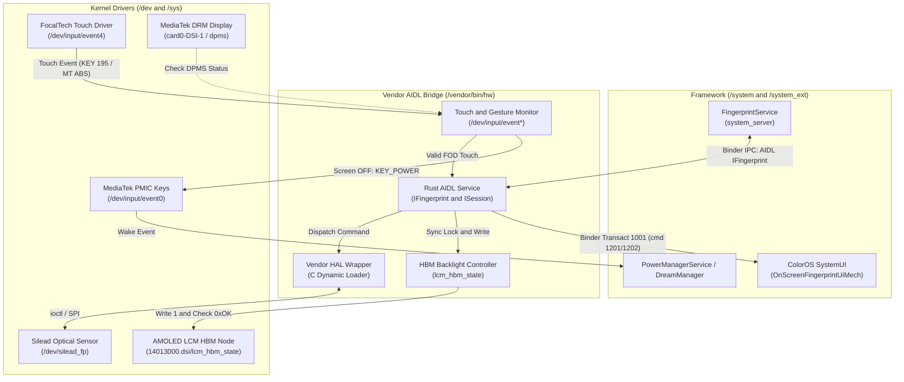
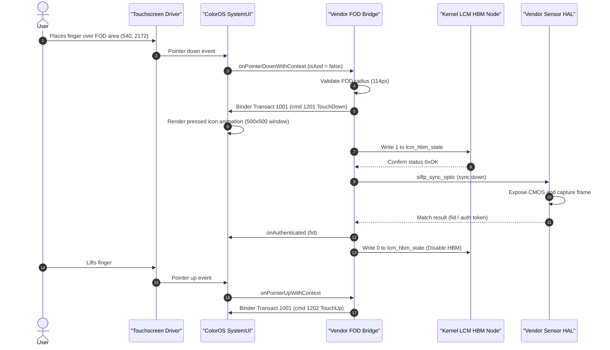
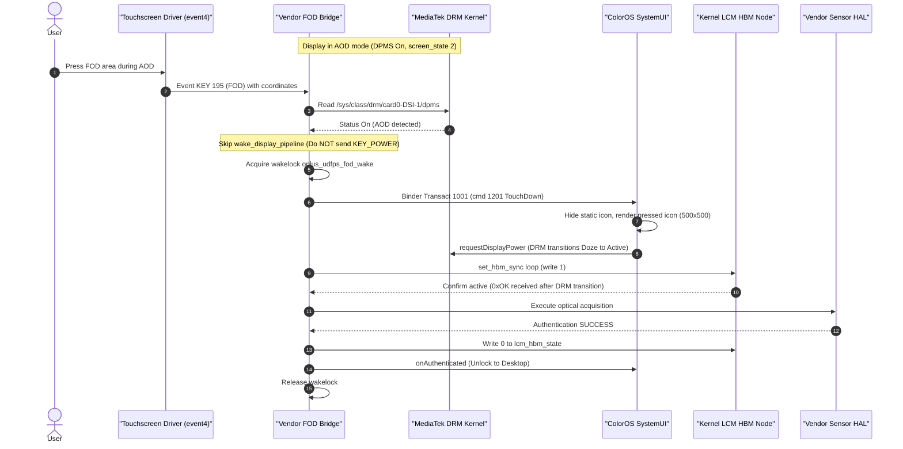
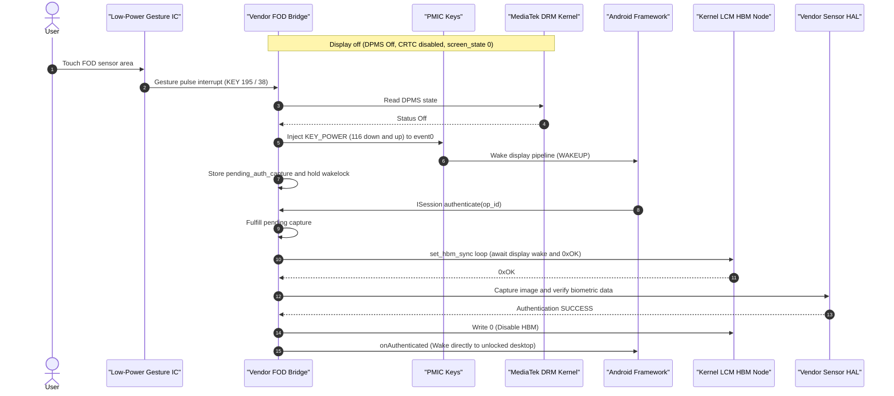

# OPlus UDFPS Bridge for Transsion (Vendor AIDL HAL)

A native Rust daemon that implements the Android AIDL fingerprint HAL (`android.hardware.biometrics.fingerprint.IFingerprint`) for Transsion devices (Tecno and Infinix on MediaTek Helio G99 / MT6789 / Dimensity platforms) running ported ColorOS 16 / 17 (Android 14+) or custom ROMs.

Supports both **Silead** optical sensors (GSL7001 / `libsl_fp_impl.so`) and **Goodix** optical sensors (GW9598 / `libgf_hal.so` / `gf_fingerprint.default.so`).

The entire implementation operates inside the `/vendor` partition, without requiring modifications to `/system` or `/system_ext`.

---

## 1. Technical Context & Problem Statement

### HAL Generation & Vendor ABI Incompatibility
- **Transsion Base vs ColorOS Framework**: Stock Transsion implementations often use legacy HIDL HAL interfaces (`android.hardware.biometrics.fingerprint@2.1/2.3`). ColorOS 16 and 17 (Android 14+) require an AIDL HAL service (`android.hardware.biometrics.fingerprint.IFingerprint`). In addition, the ColorOS `OnScreenFingerprintUiMech` framework relies on vendor-specific Binder IPC transactions on `ISessionCallback` (transaction 1001 with command 1201 for `TouchDown` and command 1202 for `TouchUp`).
- **Goodix Proprietary ABI Differences**:
  - Legacy `goodix_fingerprint_device_t` extends `hw_device_t` with a total struct size of `0x130` bytes (unlike standard AOSP's `0xf0` bytes). Function pointers (such as `enumerate` at `0xb8`, `remove` at `0xc0`, and `authenticate` at `0xd0`) reside at different offsets.
  - Goodix `remove` is a batch operation: `remove(dev, const u32 *ids, u32 count)`.
  - Goodix internal notification messages (`fingerprint_msg_t`) omit the standard AOSP `gid` (group ID) field from payloads:
    - `FINGERPRINT_TEMPLATE_ENROLLING`: `[fid (u32), samples_remaining (u32)]` (AOSP has `gid` + `fid` + `samples_remaining`). Reading standard struct offsets causes `samples_remaining` to be read as `0`, prematurely finishing enrollment on touch 1.
    - `FINGERPRINT_AUTHENTICATED`: `[fid (u32), hat (hw_auth_token_t)]`. Offset 0 is `fid` and offset 4 is `hat`.
    - `FINGERPRINT_TEMPLATE_ENUMERATING`: `[fid (u32), remaining (u32)]`.

### MediaTek Kernel HBM Gating & Control Node
- Optical under-display fingerprint sensors require the AMOLED display area above the sensor to illuminate at High Brightness Mode (HBM) during optical acquisition.
- On MediaTek Transsion devices (`nt37706a` panel / `mediatek_drm_v1`), the hardware HBM control is exposed via:
  ```text
  /sys/kernel/tran_display/lcm_hbm_state
  ```
  Writing `"1\n"` invokes the kernel display driver's `tran_lcm_hbm_store` (`panel_hbm_set_cmdq_switch en=1`). Writing `"0\n"` disables HBM.
- Reading this node returns a hex register value (e.g., `0xFA`), not `"0xOK"`. Polling for `"0xOK"` causes false timeouts.
- In ported ColorOS ROMs, the ColorOS display daemon (`vendor.oplus.hardware.displaypanelfeature@1.0-service`) fails because `/dev/oplus_display` does not exist on MTK kernels. Direct hardware control of `lcm_hbm_state` is required.

### AOD & Sleep Power Conflicts
- **Premature Dream Termination**: If an input handler injects `KEY_POWER` (keycode 116) while the device is in Always-On Display (AOD / Doze), `PowerManagerService` processes it as a physical power key press (`WAKE_REASON_POWER_BUTTON`). This triggers `DreamManager.stopDream()`, tearing down the AOD display window and destroying the on-screen fingerprint icon.
- **Empty Pressed Icon Window**: ColorOS SystemUI renders a dynamic press animation window (`OnScreenFingerprintPressedIcon`) when touch begins. If optical configuration properties (`persist.vendor.fingerprint.optical.iconsize` and `iconnumber`) are unset or set to `0` / `"none"`, SystemUI initializes this window with dimensions `0x0`. In AOD, the static icon hides to let the pressed icon render, but because the pressed icon has zero size, the fingerprint indicator completely vanishes on contact.

---

## 2. Architecture & Design

- **Native Rust AIDL Implementation**: Implements `IFingerprint` and `ISession` using `rsbinder`. Directly handles custom ColorOS transactions:
  - Command 1010: Total enrollment steps (returns 20 for ColorOS enroll progress UI).
  - Command 1011: Screen state synchronization.
  - Transaction 1001 (commands 1201/1202): Direct touch dispatch to ColorOS SystemUI.
- **Dual Vendor HAL Support**:
  - **Silead**: Loads patched `libsl_fp_impl.so` via `dlopen`/`dlsym`. Dispatches commands across a dedicated worker pool and strips non-standard vendor acquired messages (1001, 1002, 1020).
  - **Goodix**: Loads `libgf_hal.so` or `/odm/lib64/hw/gf_fingerprint.default.so`. Automatically adapts to `goodix_fingerprint_device_t` (0x130 bytes), batch removal, and unpacks vendor notify payloads without `gid`.
- **Direct Hardware HBM Controller**: Writes directly to `/sys/kernel/tran_display/lcm_hbm_state` (`1\n` / `0\n`) with fallback writes to ColorOS addon paths (`/data/addon/oplus_display/hbm` and `notify_fppress`). Uses a generation-counted safety watchdog (10s) to prevent screen burn-in.
- **Context-Aware Wake Engine**: Inspects the DRM panel state via `/sys/class/drm/card0-DSI-1/dpms`:
  - When DPMS is `Off` (deep sleep): Injects `KEY_POWER` into `/dev/input/event0` (PMIC keys) to wake the hardware display pipeline.
  - When DPMS is `On` (screen active or AOD): Suppresses power key injection completely. Holds an in-kernel wake lock (`oplus_udfps_fod_wake`) and lets ColorOS SystemUI transition the panel power state without breaking the AOD Dream lifecycle.
- **Externalized Property Configuration**: Optical dimensions (`iconsize`, `iconlocation`, `iconnumber`), animation level (`persist.sys.oplus.anim_level`), and biometric screen blocking policies (`persist.sys.block.fingerprint`) are decoupled from the compiled binary. They are configured via properties (such as `/vendor/etc/special.prop`), enabling fine-tuning without recompilation.

---

## 3. System Diagrams

### Component Architecture

The bridge links the ColorOS framework, vendor AIDL HAL interface, hardware input drivers, and kernel display nodes:



---

### Sequence 1: Screen ON Authentication

During active display conditions, touchscreen drivers forward touch events directly to ColorOS SystemUI. The bridge synchronizes High Brightness Mode (HBM) with the optical sensor capture without modifying display power states.



---

### Sequence 2: Always-On Display (AOD / Doze) Authentication

In AOD mode, the panel runs at lower refresh rates with `dpms = On`. Touch pulses arrive via kernel input `KEY 195`. The bridge suppresses `KEY_POWER` injection to prevent `PowerManagerService` from closing the AOD dream window, acquires a wakelock, dispatches touch events to SystemUI, and activates HBM.



---

### Sequence 3: Screen OFF (Deep Sleep) Authentication

When the screen is completely off (`dpms = Off`), the SoC resides in deep sleep. Touch gestures generate a low-power interrupt (`KEY 195`). The bridge detects the `Off` state, injects `KEY_POWER` into `/dev/input/event0` to wake the DRM controller, stages the biometric capture, and enables HBM once the display pipeline resumes.



---

## 4. File Layout & Vendor Integration

All artifacts install strictly into `/vendor`:

```text
/vendor/
├── bin/
│   └── hw/
│       └── android.hardware.biometrics.fingerprint-service.transsion   # Main Rust AIDL HAL binary (0755)
├── etc/
│   ├── init/
│   │   ├── android.hardware.biometrics.fingerprint-service.transsion.rc # AIDL service init config (0644)
│   │   ├── android.hardware.biometrics.fingerprint@2.1-service-mediatek.rc # Legacy HIDL service override (disabled)
│   │   └── android.hardware.biometrics.fingerprint@2.3-service.transsion.rc # Legacy HIDL service override (disabled)
│   └── vintf/
│       └── manifest/
│           ├── manifest_fingerprint_transsion.xml                      # VINTF AIDL IFingerprint declaration (0644)
│           ├── android.hardware.biometrics.fingerprint@2.1-service-mediatek.xml # Legacy VINTF stub
│           ├── android.hardware.biometrics.fingerprint@2.3-service.transsion.xml # Legacy VINTF stub
│           └── manifest_fingerprint.xml                                # Legacy VINTF stub
└── lib64/
    └── libsl_fp_impl.so                                                # Patched Silead vendor library (0644)
```

---

## 5. Source Code Structure

| Module | File | Purpose |
|---|---|---|
| **Entrypoint** | [src/main.rs](src/main.rs) | Sets up the Binder thread pool, sets the AIDL support property flag, enables gesture FOD in the kernel driver, and registers the `IFingerprint` AIDL service with `ServiceManager`. |
| **AIDL Service** | [src/service.rs](src/service.rs) | Implements `IFingerprint` and `ISession`. Handles proprietary ColorOS transactions (cmd 1010 for enrollment steps, cmd 1011 for screen state, cmd 1201/1202 for touch dispatch). |
| **HAL Wrapper** | [src/hal.rs](src/hal.rs) | Wraps vendor C `fingerprint_device_t` methods via `dlopen`/`dlsym`. Filters non-standard internal vendor codes (1001, 1002, 1020) and manages pending capture queues. |
| **Input Monitor** | [src/input.rs](src/input.rs) | Reads touch events from `/dev/input/event*`, validates coordinates against the FOD area radius (114px around 540, 2172), and injects `KEY_POWER` only when DPMS is `Off`. |
| **HBM Controller** | [src/hbm.rs](src/hbm.rs) | Manages AMOLED panel brightness mode via `/sys/devices/platform/soc/14013000.dsi/lcm_hbm_state`. Polls for `0xOK` with a 500ms safety timeout. |
| **Binary Patcher** | [patch_libsl_fp.py](patch_libsl_fp.py) | Patches `libsl_fp_impl.so` to eliminate `silfp_cust_wait_ui_ready` latency, bypass blocking ioctl `wait_finger_status`, and adjust enrollment challenge checks. |

---

## 6. System Properties

The following system properties configure optical sensor geometry, framework behavior, and UI animation modes. These properties can be placed in `/vendor/etc/special.prop` or system `build.prop` files:

```properties
# Identifies the HAL as an AIDL interface in ColorOS AuthService
vendor.fingerprint.aidl.support=1

# Disables biometrics screen-blocking policy so the AMOLED panel stays on during auth
persist.sys.block.fingerprint=false

# Dimensions of the pressed icon animation window in pixels (e.g., 200)
persist.vendor.fingerprint.optical.iconsize=200

# Vertical offset of the optical icon in pixels from the bottom of the screen
persist.vendor.fingerprint.optical.iconlocation=228

# Physical center coordinates of the sensor (X::Y format, e.g., 540::2172)
persist.vendor.fingerprint.optical.sensorlocation=540::2172

# Optical animation style index (e.g., 5 = white illumination for Silead)
persist.vendor.fingerprint.optical.iconnumber=5

# ColorOS animation render mode (2 = Frame-by-frame WebP drawables, avoids missing .coz vector assets)
persist.sys.oplus.anim_level=2
```

---

## 7. Build Instructions

### Prerequisites
- **Host OS**: Linux x86_64
- **Rust Toolchain**: `rustup target add aarch64-linux-android`
- **Android NDK**: NDK r26b or newer (`ANDROID_NDK_HOME` must be set)
- **Python**: Python 3.8+ (for binary patching)

### Compiling
Run the build script:

```bash
./build.sh release
```

The build script performs the following tasks:
1. Validates the NDK toolchain and locates the `aarch64-linux-android31-clang` compiler.
2. Compiles the Rust workspace for `aarch64-linux-android` with release profile optimizations and runs `llvm-strip`.
3. Executes `patch_libsl_fp.py` on `libsl_fp_impl.so`.
4. Assembles the `/vendor` tree inside `out/vendor/`.
5. Generates the distribution archive `out/transsion-vendor-fod-package.zip`.

---

## 8. Deployment

The build output is available in `out/transsion-vendor-fod-package.zip` and `out/vendor/`.

### Method 1: Vendor Image Integration (ROM Source)
Copy the contents of `out/vendor/` directly into your ROM's vendor source tree or unpacked `vendor.img`:
- Executable binary in `vendor/bin/hw/`: mode `0755`, SELinux context `u:object_r:hal_fingerprint_default_exec:s0`.
- Shared library in `vendor/lib64/`: mode `0644`.
- Configuration files in `vendor/etc/`: mode `0644`.

### Method 2: Manual Recovery Push (TWRP / OrangeFox)
For testing on an existing installation:

```bash
adb root
adb remount
adb push out/vendor /
```

### Method 3: Runtime Bind-Mount Testing (Read-Only EROFS Vendor/ODM)
On modern devices where `/vendor` and `/odm` are read-only EROFS partitions, test dynamically using bind-mounts without flashing:

```bash
# Push binary to temporary writable storage
adb push out/vendor/bin/hw/android.hardware.biometrics.fingerprint-service.transsion /data/local/tmp/fp-bridge
adb shell "chcon u:object_r:hal_fingerprint_default_exec:s0 /data/local/tmp/fp-bridge"

# Stop existing service, bind-mount over stock binary, and restart
adb shell "
setprop ctl.stop vendor.fingerprint-default
sleep 1
umount /vendor/bin/hw/android.hardware.biometrics.fingerprint-service 2>/dev/null
mount --bind /data/local/tmp/fp-bridge /vendor/bin/hw/android.hardware.biometrics.fingerprint-service
chcon u:object_r:hal_fingerprint_default_exec:s0 /vendor/bin/hw/android.hardware.biometrics.fingerprint-service
setprop ctl.start vendor.fingerprint-default
"
```

---

## 9. Verification & Diagnostics

Verify service status and operation using ADB.

### 1. Check Service Registration
```bash
adb shell dumpsys activity service android.hardware.biometrics.fingerprint.IFingerprint/default
```

### 2. Monitor Authentication and HBM Logs
```bash
adb logcat -s oplus_udfps_transsion
```

Typical output during successful enrollment and HBM capture:
```text
I oplus_udfps_transsion: FOD touch coordinate confirmed via SYN_REPORT at (530, 2192) -> activating HBM and capture
I oplus_udfps_transsion: on_pointer_down at (530, 2192) (screen_state=1) -> activating HBM & optical capture
I oplus_udfps_transsion: Hardware LCM HBM & OPPO display enabled
I oplus_udfps_transsion: Enroll progress: raw_fid -2135191572, raw_remaining 10
I oplus_udfps_transsion: Hardware LCM HBM & OPPO display disabled
I oplus_udfps_transsion: Reporting enrollment progress: fid -2135191572, remaining 10
...
I oplus_udfps_transsion: Enrollment completed successfully (final fid -2135191572)
```

Verify in kernel dmesg that hardware HBM toggles cleanly:
```bash
adb shell "dmesg | grep -E 'tran_lcm_hbm|panel_hbm'"
```
```text
[LCM] panel_hbm_set_cmdq_switch FPS=120Hz en=1, mapped_level=656, aod=0
[LCM] panel_hbm_set_cmdq_switch FPS=120Hz en=0, mapped_level=656, aod=0
```

### 3. Verify Pressed Icon Window Dimensions
Confirm that the SystemUI animation window has valid dimensions (`500x500` rather than `0x0`):
```bash
adb shell "dumpsys window windows | grep -A 10 'OnScreenFingerprintPressedIcon'"
```
The output should report `Requested w=500 h=500`.
